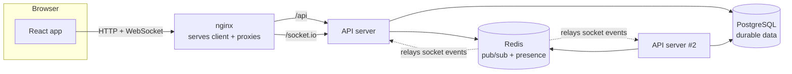
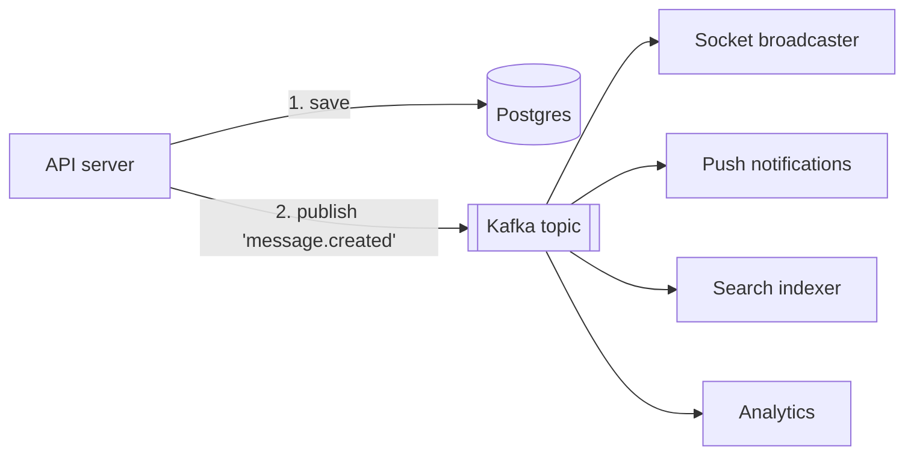

# Architecture

A guided tour of how Mini Telegram is put together, written to be **studied**.
It explains not just *what* each piece is, but *why* it's there and where you'd
take it next.

## The big picture



Five moving parts:

| Piece | Tech | Responsibility |
|---|---|---|
| **Client** | React + TypeScript, built by Vite, served by **nginx** | The UI. Static files. Talks to one origin. |
| **API server** | Node + Express + Socket.IO | REST endpoints + realtime. Stateless — you can run many. |
| **Database** | **PostgreSQL** (via Prisma) | The source of truth: users, chats, messages. |
| **Cache/bus** | **Redis** | Cross-server event relay + online presence. |
| **Reverse proxy** | nginx (in the client image) | Serves the app and forwards `/api` + `/socket.io` to the server. |

## Two ways data flows

**1. Request/response (REST)** — for things that aren't time-critical:
`register`, `login`, `me`, list chats, load message history, create/leave a chat.
Classic HTTP: the browser asks, the server answers.

**2. Realtime (WebSocket via Socket.IO)** — for things that must feel instant:
sending a message, "is typing…", and online/offline. The server can **push** to
the browser without being asked.

> Loading old messages is REST; new messages arrive over the socket. That split
> is deliberate — history is a one-off fetch, live updates are a stream.

## The realtime scaling story (the important bit)

A single server holds WebSocket connections in memory, so `io.to(room).emit()`
just works. But **one server doesn't scale** — real systems run several behind a
load balancer. Then a problem appears:

> Alice is connected to **server A**. Bob is connected to **server B**. Bob sends
> a message. Server B has never heard of Alice's socket. How does she get it?

The answer is the **Socket.IO Redis adapter** (`server/src/index.ts`). Every
server publishes its emits to Redis, and every server subscribes. So an emit on
B is relayed through Redis to A, which delivers it to Alice. The application code
(`io.to(...).emit(...)`) doesn't change at all — the adapter makes "emit" work
cluster-wide.

**Presence** has the same problem: a per-process counter would only know about
*that* server's connections. So presence lives in a **Redis hash**
(`presence:counts`, see `server/src/socket.ts`): each connect does an atomic
`HINCRBY +1`, each disconnect `-1`, and the 0↔1 transitions broadcast
online/offline. Any server can read the shared truth.

## Where Kafka would fit (your future study project)

Today, sending a message does two things inline:

```
message:send  ->  save to Postgres  ->  broadcast over sockets
```

That's perfect at this scale. Kafka earns its place when you want a **durable,
replayable event log** that **multiple independent services** consume. The seam:



Instead of the server doing the broadcast directly, it **publishes an event** to
a Kafka topic, and separate consumers each react: one fans it out over sockets,
one sends push notifications, one updates a search index, one records analytics.
Benefits: services are decoupled, events are durable (a consumer that was down
can catch up), and you can add new consumers without touching the producer.

**Why not now?** With one service and modest scale it's pure operational weight.
Redis pub/sub already gives us cross-server fan-out. Kafka is the *next* rung —
and because the write path is centralized in `socket.ts`, adding it later is a
contained change, not a rewrite.

## Security

| Concern | How it's handled |
|---|---|
| Passwords | Hashed with **bcrypt**; never stored or returned in plaintext |
| Sessions | **JWT** signed with a validated secret; verified on every REST call *and* socket connection |
| Input | **zod** schemas validate every request body and socket payload |
| Headers | **helmet** sets sensible security headers |
| CORS | Restricted to `CLIENT_ORIGIN` (not `*`) |
| Brute force | **express-rate-limit** on `/api/auth` |
| Body size | JSON capped at 100 kb |
| Authorization | Membership is checked before reading/posting in any chat |

## Configuration

All environment variables are validated once at startup by
`server/src/config.ts` (zod). If something required is missing or malformed, the
process exits immediately with a clear message — no mystery crashes later.

| Var | Meaning |
|---|---|
| `DATABASE_URL` | Postgres connection string |
| `REDIS_URL` | Redis connection string |
| `JWT_SECRET` | Token signing secret (≥ 16 chars) |
| `CLIENT_ORIGIN` | Allowed browser origin(s), comma-separated |
| `PORT`, `NODE_ENV` | Standard |

## Data model

```
User(id, username unique, password[bcrypt], createdAt)
Chat(id, type['direct'|'group'], name?, createdAt)
Member(id, chatId, userId, joinedAt)   UNIQUE(chatId,userId)   -- join table
Message(id, chatId, senderId, content, createdAt)
```

A 1:1 chat and a group are the *same* `Chat` — just 2 members vs. many. Foreign
keys cascade on delete; hot lookups (`Member.userId`, `Message.chatId`) are
indexed.

## Running it

See the [README](README.md) for commands. In short:
- **Dev:** `docker compose up -d db redis` (infra) + `npm run dev` (hot-reload app)
- **Full stack:** `docker compose up --build` → app at `http://localhost:8080`

## Deliberately left for later (good study exercises)

- **Refresh tokens** in httpOnly cookies (JWT-in-localStorage is simple but XSS-exposed)
- **Presence resilience**: a heartbeat + TTL so a crashed server doesn't leave stale "online" entries
- **Message pagination** (right now history loads in full)
- **Automated tests** + CI/CD
- **Observability**: metrics (Prometheus) and tracing
- **Kafka** event log, per the seam above
